<!-- metrics:start -->
| | |
|---|---|
| CVEs reported to maintainers | **3** |
| Malicious repositories confirmed | **425** |
| Malicious container images confirmed | **289** |
| Hunting since | **2026-06-14** |

| Findings in the evidence store | |
|---|---|
| Listed below (repositories, containers, extensions) | **540** |
| Reported to OSM by us | **304** |
| Already in OSM, confirmed independently and enriched | **79** |
| Confirmed, OSM report not recorded | **157** |

_Updated 2026-10-17_
<!-- metrics:end -->

- **CVEs reported:** vulnerabilities reported privately to the maintainer. Package names are listed once the advisory is public.
- **Malicious repos:** confirmed by [git_warden](https://github.com/OpenSource-For-Freedom/git_warden).
- **Malicious containers:** confirmed by [KNORR](https://github.com/OpenSource-For-Freedom/KNORR).

Updated every Monday after the weekly hunts, and daily. Totals are all reports submitted to OpenSourceMalware (repositories and container images), including reports filed before git_warden's and KNORR's ledgers existed; the lists below show the entries in those ledgers. Hunting began 2026-06-14, when git_warden started; KNORR joined 2026-07-07.

## Confirmed list

Every confirmed finding in the evidence store, less reviewer-rejected false positives. **OSM** reads `reported` when the ledger recorded the OpenSourceMalware submission; earlier reports filed before the ledger began show as `not recorded` (see [my submissions](https://opensourcemalware.com/my-submissions)). Names are shown as text, not links.

<!-- confirmed:start -->

<b>Malicious repositories (337)</b>

| Repository | Family | OSM |
|---|---|---|
| `123babayaga/zenithive_angular` | general | not recorded |
| `16navigabraham/stakely-miniapp` | general | already in OSM |
| `777genius/review-router-ai` | general | reported |
| `aaryan121/code-conductor-fork` | general | reported |
| `abdurrahman224/admin-dash` | general | reported |
| `abdurrahman224/diego` | general | not recorded |
| `abdurrahman224/kodesolution` | general | reported |
| `abdurrahman224/personal-portfolio-website` | general | reported |
| `abdurrahman224/weather-app-redux` | general | reported |
| `adan-asim/e-commerce-admin-app-backend` | general | reported |
| `adaptive-liquidity/aeon-lab` | general | reported |
| `addis-ale/git_learn` | general | not recorded |
| `adity-design/assessment` | general | not recorded |
| `agrawalchirag/corex` | general | not recorded |
| `ahmadraza382/apis-integration` | general | reported |
| `ai-tech-vision/acnplay-demo` | general | already in OSM |
| `aidevshakil055/achillcomfort_ai_repo` | general | reported |
| `alexsander532/atlas_landingpage` | general | reported |
| `alexsander532/mvp_wain_group130` | general | reported |
| `alexsander532/portfolio-pessoal` | general | reported |
| `alexsander532/projeto_dashboard_versao1` | general | reported |
| `alexsander532/synapse_ai` | general | reported |
| `alexsander532/synapseai` | general | reported |
| `alexsander532/synapseai_landingpage` | general | reported |
| `allzone-technologies/canteen-pwa` | general | already in OSM |
| `alpascal1010/genetiq-beta` | general | already in OSM |
| `altura-hub111/altura-mvp` | general | already in OSM |
| `anasbinarif/texas-2026` | general | not recorded |
| `andre1917/challenge` | general | not recorded |
| `anshuman-jha/toku_assestment` | general | not recorded |
| `antonver/defiguard-dev` | general | already in OSM |
| `arif1101/restaurant-management-server` | general | not recorded |
| `arnoldesquivel/best-city436-poc` | general | not recorded |
| `asad-ghafoor/python-setup` | general | reported |
| `autonomys-nexus/autonomys` | general | already in OSM |
| `bernardonuh/rubic-test1` | general | already in OSM |
| `berry2012/amazon-ecs-demo` | general | not recorded |
| `bhnybrohn/cal-eco-platform` | general | already in OSM |
| `bhoomikamehtastartbit/reactchakraui` | general | not recorded |
| `blockdaemon-hub103/world-light` | general | already in OSM |
| `bloxberg-d/jackpot` | general | already in OSM |
| `boundaryml/baml` | general | not recorded |
| `branch8/polinriderscanner` | general | not recorded |
| `bsai/cal-eco-platform` | general | already in OSM |
| `buidlguidl/launchpod` | general | already in OSM |
| `buxomapp/barfas` | general | not recorded |
| `buxomapp/barfas-server` | general | not recorded |
| `caprico1/deepce` | general | not recorded |
| `caprico1/docker-botnets` | general | not recorded |
| `cataclypsme/old-web3-project` | general | reported |
| `chainfliplabs141/chainfliplabs-platform` | general | already in OSM |
| `chayildeborah/space-shootes` | general | already in OSM |
| `cletusgizo/genetiq-v2--test-task` | general | already in OSM |
| `cline/cline` | general | not recorded |
| `cogni-capital-chain/socifi-mvp` | general | not recorded |
| `collebrusco/frontier` | minecraft | reported |
| `crazydev13/school-management` | general | not recorded |
| `cybercop-404/termux-setup` | general | not recorded |
| `dapperlabsmd/dapperlabs-mvp` | general | not recorded |
| `darkbl0x/ddos-ripper-v2.1` | minecraft | reported |
| `data3rr/steal-eyes` | minecraft | reported |
| `david1savitsky/cal-eco-platform` | general | reported |
| `david1savitsky/cal-eco-platform2` | general | not recorded |
| `dawit212119/anbessa` | general | reported |
| `dawit212119/bus-admin` | general | reported |
| `dawit212119/eaglepoint-ai` | general | reported |
| `dawit212119/ecommerce-backend` | general | not recorded |
| `dawit212119/go` | general | reported |
| `dawit212119/nextebook` | general | reported |
| `dawit212119/wetruck` | general | reported |
| `devba/lmng-top-` | general | not recorded |
| `devba/w3agregador` | general | reported |
| `devthedeveloper/w3glpop` | general | already in OSM |
| `differenz-system/addressbook.nextjs` | general | reported |
| `dishankchauhan/tech_test_pro-assignment` | general | not recorded |
| `disneyxix/ecommerce` | general | already in OSM |
| `djeday123/test_repo1` | general | not recorded |
| `dominion116/solwork` | general | already in OSM |
| `duceboxedu/tiktoklikebot` | minecraft | reported |
| `dylanlittle/team-moshpit-project` | general | already in OSM |
| `eastmade/web3project-momo-token` | general | already in OSM |
| `eferos93/test4` | general | already in OSM |
| `emam-bokhari/resellbd-client-` | general | already in OSM |
| `emandeveloper/datascience` | general | reported |
| `emigimenezj/solice2021-school-management-system` | general | already in OSM |
| `ethansliu/software_space_skill_test_problem_1` | general | not recorded |
| `exquisify/hello-world-api` | general | already in OSM |
| `fadi002/decompiled-stuff` | minecraft | reported |
| `findusman/pos_backend` | general | already in OSM |
| `forthekingfck/lazyqol` | minecraft | reported |
| `fullstack-manmohan/htw-collab` | general | already in OSM |
| `gauravraisharma/inventorymanagementsystem` | general | reported |
| `gauravraisharma/ticketting-system` | general | reported |
| `goldendragon68/bullana` | general | not recorded |
| `goldendragon68/cryptoket-smart-contracts` | general | reported |
| `goldendragon68/nft-marketplace` | general | reported |
| `groot-software-solutions/flutter-apps` | general | already in OSM |
| `gru-lucy/notification-demo` | general | already in OSM |
| `guitinem/carting_assessment` | general | not recorded |
| `hakeemsyd/fastapi-rag` | general | already in OSM |
| `hambaloch/carting-assessment` | general | not recorded |
| `hammad911/datavisualizationproject` | general | not recorded |
| `hanjobulking7/portafolio` | general | already in OSM |
| `haroldcalvo/c-_final_startup_project` | general | reported |
| `haroldcalvo/portfolio_website` | general | reported |
| `haroldcalvo/quil_project` | general | reported |
| `haroldcalvo/workshop` | general | reported |
| `haroontaufiq/cosmic-questionnaire` | general | reported |
| `heamlk/next.js-automation` | general | already in OSM |
| `helidonashabani/student-management` | general | not recorded |
| `httphypixelnet/ratmod` | minecraft | reported |
| `huncholane/defi_property` | general | already in OSM |
| `hvmgeeks/frontendengine1` | general | already in OSM |
| `icecoldjay/bri` | general | reported |
| `ihzhatamamy/-magicdoor_property_rental` | general | not recorded |
| `ilyavafin/lol` | minecraft | reported |
| `ishanrt119/nft-marketplace` | general | reported |
| `itsmeblackops/wisepanda-bot-main` | general | not recorded |
| `jaxteller2016/social-app-mvp-poker-cra` | general | reported |
| `jjin43/invelo_assessment` | general | not recorded |
| `jmhelmy/therapistdb` | general | already in OSM |
| `jobayer-hossen/l2-assignment-3` | general | already in OSM |
| `juanmantica123/funtico-tech-assestment` | general | reported |
| `kamilniftaliev/unipay` | general | already in OSM |
| `karventhan-k/chat_widget-` | general | already in OSM |
| `khamid-v2022/auto-stacking` | general | reported |
| `komangmahendra/rental-prop-task` | general | not recorded |
| `kreliannn/attendance-system-backend` | general | reported |
| `kreliannn/bfar-management-system-backend` | general | reported |
| `kreliannn/book-swap-platform` | general | reported |
| `kreliannn/burger-shop-webiste` | general | reported |
| `kreliannn/cafe-ordering-system` | general | reported |
| `kreliannn/canteen-food-reservation-system-` | general | reported |
| `kreliannn/color-click-web-game` | general | reported |
| `kreliannn/community-waste-system-backend` | general | reported |
| `kreliannn/grocery-pos-system` | general | reported |
| `kreliannn/hotel-rental-backend` | general | reported |
| `kreliannn/house-rental-platform` | general | reported |
| `kreliannn/kreliannn` | general | reported |
| `kreliannn/mobile-web-view` | general | reported |
| `kreliannn/musicplayer` | general | reported |
| `kreliannn/pharmacy-management-backend` | general | reported |
| `kreliannn/pokedex-clone-backend` | general | reported |
| `kreliannn/quiz-builder-reviewer` | general | reported |
| `kreliannn/restaurant-pos-system` | general | reported |
| `kreliannn/samg-barracks-backend` | general | reported |
| `kreliannn/school-website-bootsrap` | general | reported |
| `kreliannn/secure-quiz-management-system` | general | reported |
| `kreliannn/tiktok-clone-backend` | general | reported |
| `kreliannn/xox-game` | general | reported |
| `laerciosimoes/giit-challenge-laercio` | general | already in OSM |
| `lambeboluwatife/nextjs-crash-course` | general | already in OSM |
| `lfirsl/morphix` | general | not recorded |
| `lithira-silva/trueclaim---itpm-` | general | already in OSM |
| `logixbuilttech/payload_posts` | general | reported |
| `lolminerxmrig0001/git` | general | not recorded |
| `lordhaka/photo` | minecraft | reported |
| `lordhaka/token-logger` | minecraft | reported |
| `luka147m/r-gradani` | general | not recorded |
| `lunagrabber/luna-grabber-2.1` | minecraft | reported |
| `mahnoorkhushbakht/test-assesment` | general | not recorded |
| `mallah-elmehdi/innovation` | general | already in OSM |
| `markomilivojevic/ethvault_staking` | general | already in OSM |
| `mdabdulkyum1/xynexa` | general | already in OSM |
| `meharab/scam-origin` | general | reported |
| `mentarishub121/tokenpresaleapp` | general | reported |
| `mlflow/dev` | general | not recorded |
| `mlflow/mlflow` | general | not recorded |
| `modish0161/poo-land-app` | general | not recorded |
| `modish0161/tiger-world-maze` | general | not recorded |
| `mohamedeturki/shigud-clone` | general | already in OSM |
| `motia/goldencity` | general | reported |
| `msmilan69/result-task` | general | reported |
| `mts-services/asalmiah_nextjs_fixing` | general | already in OSM |
| `mts-services/brittanirisher_frontend` | general | reported |
| `mts-services/chuckdudley_laravel` | general | reported |
| `mts-services/diego_lms_frontend` | general | reported |
| `mts-services/drorange0_2_26` | general | reported |
| `mts-services/energiesol_laravel_13_01_26` | general | reported |
| `mts-services/kenndavi2_bbq_sauce_15_02_26_laravel` | general | reported |
| `mts-services/kenndavi2_clothing_15_02_26_laravel` | general | reported |
| `mts-services/kenndavi2_react` | general | reported |
| `mts-services/m19logistics_backend` | general | reported |
| `mts-services/macktech_laravel` | general | reported |
| `mts-services/may_writes` | general | reported |
| `mts-services/michaelalleva_04_march_26` | general | reported |
| `mts-services/mikylepersad_tow_truck_laravel` | general | reported |
| `mts-services/ok2wg5c6d_tareenhossain` | general | reported |
| `mts-services/olabisiolai_frontend_react` | general | reported |
| `mts-services/outside_dan` | general | reported |
| `mts-services/sdell20_laravel12` | general | reported |
| `mts-services/simonluisjeger_laravel_17_01_2026` | general | reported |
| `mts-services/timescape_laravel_26` | general | reported |
| `mts-services/tungsol_dictionary_1_26` | general | reported |
| `mts-services/z1_cookid_laravel` | general | reported |
| `mts-services/zaidabulaila613_latest` | general | reported |
| `muhammad-sharique/insta-download` | general | reported |
| `mulagoto/vespy-grabber-v2.0` | minecraft | not recorded |
| `multi-too/luna-graber-main` | minecraft | reported |
| `ndevu12/stayawakebot` | general | reported |
| `nelsondev19/defi-property` | general | already in OSM |
| `neotree/security-ci` | general | reported |
| `nhonlvsoict/skill-test-main` | general | not recorded |
| `nilsrusten-dev/mysite` | general | already in OSM |
| `niyathi-ramesh/test_demo` | general | not recorded |
| `noors-code/demo-repo-` | general | reported |
| `noors-code/flask` | general | reported |
| `noors-code/medical-messaging` | general | reported |
| `noors-code/moviehouse` | general | reported |
| `noors-code/moviehouse-api` | general | reported |
| `noors-code/swarrpay-backend` | general | reported |
| `novaremix-tech/vault-new-phase` | general | reported |
| `nurfarazi/3tier` | general | reported |
| `nurfarazi/ai-agent-demo` | general | reported |
| `nurfarazi/auto-approve-hr` | general | reported |
| `nurfarazi/cccam_util` | general | reported |
| `nurfarazi/e-commerce-mvp` | general | reported |
| `nurfarazi/excel2google_autopilot` | general | reported |
| `nurfarazi/gome` | general | reported |
| `nurfarazi/node-sql-playground` | general | reported |
| `nurfarazi/nono-chat-bot` | general | reported |
| `nurfarazi/nurfarazi` | general | reported |
| `nurfarazi/piece_of_cake_laundry` | general | reported |
| `nurfarazi/safemailer` | general | reported |
| `nurfarazi/safemailer-ts` | general | reported |
| `nurfarazi/sql-docker` | general | reported |
| `nurfarazi/user-management-using-cleanarchitecture` | general | reported |
| `nvidia/model-optimizer` | general | not recorded |
| `nxvh1337/pua-encoder` | general | reported |
| `okanaslan/tirios` | general | not recorded |
| `omer-prime/gold-streaming-app` | general | already in OSM |
| `osasalohan/blusalt2` | general | already in OSM |
| `photoprism/photoprism` | general | not recorded |
| `prahaladbelavadi/coinlocatordemo` | general | reported |
| `pratikp72/brainbattle` | general | reported |
| `pratikp72/calendar-app` | general | reported |
| `pratikp72/phoenixnext` | general | reported |
| `pratikp72/strollr-app` | general | reported |
| `pratikp72/taoufik_ticket_management` | general | reported |
| `prit-nadoda/the-communicare-ai-backend` | general | already in OSM |
| `prodkt-cloud/prodkt-frontend-api` | general | reported |
| `prodsec-opti/badcode` | general | already in OSM |
| `prosigns/nestjs-api-boilerplate` | general | already in OSM |
| `raduc4/defi-propery` | general | already in OSM |
| `rajaxcodes/token-presale-dapp` | general | reported |
| `ravirajsolanki01/stylehut-be` | general | already in OSM |
| `rejoan121615/va-disability-rating-calculator` | general | not recorded |
| `ricardomartins9899/smartpay-demo` | general | not recorded |
| `riteshahir28/myfirstproject` | general | already in OSM |
| `riteshahir28/new-ritesh` | general | reported |
| `riteshahir28/onlineexamsystem` | general | reported |
| `riteshahir28/poll-voting-app` | general | reported |
| `riteshahir28/portfolio` | general | reported |
| `roberto328/tokenpresaledapp` | general | not recorded |
| `ru-yaka/p` | general | not recorded |
| `ryane23/buseasejunefinal` | general | reported |
| `sabbirnde/nava` | general | reported |
| `sabbirnde1/nava` | general | reported |
| `saifullah-max/sound-cloud-downloader` | general | reported |
| `sakilanwar12/js-utility-method` | general | already in OSM |
| `sanjeevafk/agent-skills` | general | reported |
| `sathudeva7/crypto_loan_backend` | general | already in OSM |
| `sergous/dlabs-platform-mvp2` | general | not recorded |
| `shakibul22/method-client` | general | already in OSM |
| `shamratx/ai-banking` | general | not recorded |
| `shanfei/golden-city` | general | not recorded |
| `sharmapranay38/new_age_blockchain` | general | already in OSM |
| `shimul-12/token-presale-dapp` | general | reported |
| `shri33/crypto-trading-platform` | general | reported |
| `shubhojit-17/home-assessment` | general | reported |
| `siamarefin/cardiovascular-disease-prediction` | general | already in OSM |
| `simalchaudhari/bookdesk` | general | reported |
| `simalchaudhari/jaggery-backend` | general | reported |
| `simalchaudhari/member-management` | general | reported |
| `simalchaudhari/real-estate` | general | reported |
| `simalchaudhari/spin` | general | reported |
| `sky-cook/tokentradingdapp` | general | not recorded |
| `smartcoindev389/colorstudio-react` | general | already in OSM |
| `smit455/arc` | general | reported |
| `softvence-omega-cyber-monk/cheesuschrusty-server` | general | already in OSM |
| `solarpy/caroline119-defi-property-4e3a113352e3` | general | not recorded |
| `solutionsdevop/bestcity-project` | general | not recorded |
| `sovkay/goldencity` | general | not recorded |
| `soyibjonxomidjonov/scholarmap` | general | not recorded |
| `soyibjonxomidjonov/soyibjon-portfolio-shops` | general | not recorded |
| `speedydevv1/buildthisnow-saas-skeleton` | general | reported |
| `sumaiyanishat/b12a01-landing-launchpad` | general | already in OSM |
| `sumaiyanishat/b12a02-responsive-flowers` | general | already in OSM |
| `sumaiyanishat/digit-recognition` | general | already in OSM |
| `sumaiyanishat/english-janala` | general | already in OSM |
| `ta3pks/decentralized-social` | general | not recorded |
| `tataplus2/setup` | general | not recorded |
| `teeps-heisenberg/agentic-rag-assignment` | general | reported |
| `teeps-heisenberg/annclassification` | general | reported |
| `teeps-heisenberg/crewaiagentic-assignment` | general | reported |
| `teeps-heisenberg/diabetes-analysis` | general | reported |
| `teeps-heisenberg/fincan-fe` | general | reported |
| `teeps-heisenberg/git-starter` | general | reported |
| `teeps-heisenberg/khetiai-backend` | general | reported |
| `teeps-heisenberg/langchain-huggingface-generative-ai` | general | reported |
| `teeps-heisenberg/langchain-task` | general | reported |
| `teeps-heisenberg/mcp-dummy` | general | reported |
| `teeps-heisenberg/mcp-server-fast-mcp` | general | reported |
| `teeps-heisenberg/metro-bus---route-planner---backend` | general | reported |
| `teeps-heisenberg/multitoolsapi-agent` | general | reported |
| `teeps-heisenberg/python-again` | general | reported |
| `teeps-heisenberg/semantic-analysis-template` | general | reported |
| `teeps-heisenberg/smart-ai-cricket-paddle-booking-receptionist` | general | reported |
| `teeps-heisenberg/sqlagent` | general | reported |
| `terradharitri/drt-dune-analytics-service` | general | already in OSM |
| `theanuragg/ai-chat` | general | already in OSM |
| `tlord101/hck` | general | not recorded |
| `tms7331/socialverse` | general | already in OSM |
| `tsiontesfaye/assignment` | general | not recorded |
| `umershafiq19/connectify` | general | reported |
| `umrasghar/json-path-explorer` | general | reported |
| `umrasghar/surprise-site` | general | reported |
| `umrasghar/umrasghar.github.io` | general | reported |
| `umrasghar/webflow-automator` | general | reported |
| `uribresler/elevated-spaces-backend` | general | reported |
| `user2745/dev-test-kamto-kionos` | general | not recorded |
| `user2745/web3aggregator` | general | reported |
| `usmanaliashraf/portfolio` | general | reported |
| `usmanaliashraf/rag-bot-uet-science-society` | general | reported |
| `usmankhan16677/messageforge` | general | already in OSM |
| `vasillax12/vasillaxsms` | minecraft | reported |
| `vb352/koinos-assessment` | general | not recorded |
| `vishurizz/events-freelance-apk-deployment` | general | already in OSM |
| `vladyslav0060/cp-authorization` | general | already in OSM |
| `vocion/vocion-core` | general | reported |
| `workbooks-sh/workbooks.sh` | general | not recorded |
| `workonlly/interview_bucket` | general | already in OSM |
| `wyrustaaruz/cal-eco-platform` | general | not recorded |
| `yaroslav781/drainer` | general | reported |
| `zusyaku/hacking-software-v3` | general | not recorded |
| `zusyaku/script-nuyul-termux` | general | not recorded |
| `zusyaku/termux-and-kali-linux-v3` | general | not recorded |

<b>Malicious container images (203)</b>

| Image | Publisher | OSM |
|---|---|---|
| `a2pastor/docker-xmr-stak` | `a2pastor` | reported |
| `a2pastor/docker-xmrig-tls` | `a2pastor` | reported |
| `airmod/ccminer-cuda` | `airmod` | reported |
| `airmod/pl-worker` | `airmod` | reported |
| `amar266/cpu-minor` | `amar266` | reported |
| `amar266/cpuminer` | `amar266` | reported |
| `andarezta/andarezta-ccminer` | `andarezta` | reported |
| `andarezta/cpuminer` | `andarezta` | reported |
| `andarezta/xmrig-cpu` | `andarezta` | not recorded |
| `arayan/monero-miner` | `arayan` | not recorded |
| `arunkarthick34/xmrig` | `arunkarthick34` | reported |
| `asecoinio/cpuminer` | `asecoinio` | reported |
| `atul6singh/cpuminer` | `atul6singh` | reported |
| `ayeks/reverse_shell` | `ayeks` | reported |
| `bardiir/docker-cpuminer` | `bardiir` | not recorded |
| `bobvane/xmrig` | `bobvane` | not recorded |
| `bowwow/xmr-miner-autobuild` | `bowwow` | not recorded |
| `bowwow/xmr-miner02` | `bowwow` | not recorded |
| `brianpugh/monero-miner` | `brianpugh` | not recorded |
| `btcx/xmr-stak` | `btcx` | reported |
| `camelot1815/miners` | `camelot1815` | not recorded |
| `camelot1815/srbminer-docker` | `camelot1815` | not recorded |
| `cplilqw/monero-miner` | `cplilqw` | reported |
| `cryptoandcoffee/akash-monero` | `cryptoandcoffee` | reported |
| `cryptoandcoffee/cpu-akash-cpuminer-gr-avx2` | `cryptoandcoffee` | not recorded |
| `cryptoandcoffee/cpu-akash1-cpuminer-gr-avx2` | `cryptoandcoffee` | not recorded |
| `cryptoandcoffee/cpu-cpuminer-gr-avx2` | `cryptoandcoffee` | not recorded |
| `cryptoandcoffee/cpu-ocean-xmrig` | `cryptoandcoffee` | reported |
| `cryptoandcoffee/cpu-srbminer-minotaur` | `cryptoandcoffee` | not recorded |
| `cryptoandcoffee/cpu-tkinjo1985-arm` | `cryptoandcoffee` | not recorded |
| `cryptoandcoffee/cpu-xmrig` | `cryptoandcoffee` | reported |
| `cryptoandcoffee/cpu-yespowerltncg` | `cryptoandcoffee` | reported |
| `cryptoandcoffee/nvidia-docker-ccminer-alexis78-c75` | `cryptoandcoffee` | reported |
| `cryptoandcoffee/nvidia-docker-ccminer-alexis78-c8` | `cryptoandcoffee` | reported |
| `cryptoandcoffee/nvidia-docker-ccminer-alexis78-c9` | `cryptoandcoffee` | reported |
| `cryptoandcoffee/nvidia-docker-meta-miner` | `cryptoandcoffee` | reported |
| `cryptoandcoffee/nvidia-docker-meta-miner-c10` | `cryptoandcoffee` | reported |
| `cryptoandcoffee/nvidia-docker-wildrig-c10` | `cryptoandcoffee` | reported |
| `cryptocurrency/xmr-stak-cpu` | `cryptocurrency` | not recorded |
| `cryptohash/xmrig-docker` | `cryptohash` | reported |
| `crzidea/nicehash-cryptonight` | `crzidea` | not recorded |
| `d0whc3r/docker-tsiv-ccminer-cryptonight` | `d0whc3r` | reported |
| `dagopherboy/xmrig` | `dagopherboy` | not recorded |
| `dagopherboy/xmrig-cpu-monero-armf` | `dagopherboy` | not recorded |
| `denfle/reverse-shell` | `denfle` | reported |
| `donafro/monero` | `donafro` | reported |
| `donafro/xmrig` | `donafro` | reported |
| `dorin88/baru` | `dorin88` | not recorded |
| `dorin88/duogubluk` | `dorin88` | not recorded |
| `dorin88/fit` | `dorin88` | not recorded |
| `dorin88/gilang` | `dorin88` | not recorded |
| `dorin88/gublukbersinar` | `dorin88` | not recorded |
| `dorin88/maukemana` | `dorin88` | reported |
| `dorin88/srb` | `dorin88` | reported |
| `dorin88/tempemendoan` | `dorin88` | reported |
| `dorin88/tes` | `dorin88` | not recorded |
| `dorin88/xmrig` | `dorin88` | reported |
| `ekpyrosis/monero-miner` | `ekpyrosis` | not recorded |
| `ezminers/xmrig-monero-miner` | `ezminers` | reported |
| `fabriziogaliano/monero-miner` | `fabriziogaliano` | not recorded |
| `ghcr.io/cniweb/cpuminer-opt` | `cniweb` | reported |
| `ghcr.io/codekow/xmrig` | `codekow` | not recorded |
| `ghcr.io/codekow/xmrig-proxy` | `codekow` | not recorded |
| `ghcr.io/ktololp/monero-farm-panel` | `ktololp` | not recorded |
| `ghcr.io/metal3d/xmrig` | `metal3d` | not recorded |
| `ghcr.io/murf2/xmrig.docker` | `murf2` | not recorded |
| `ghcr.io/spencershepard/xmrig-d` | `spencershepard` | reported |
| `giansalex/monero-miner` | `giansalex` | reported |
| `github.com/201100084/azurerev:dockerfile` | `201100084` | reported |
| `github.com/bong9696/docker-rev:dockerfile` | `bong9696` | reported |
| `github.com/ckmaenn/shello-2105:dockerfile` | `ckmaenn` | reported |
| `github.com/dvkunion/test_ci:dockerfile` | `dvkunion` | reported |
| `github.com/essobi/dockerfiles:data/a/adamoss/touchdown/dockerfile` | `essobi` | reported |
| `github.com/essobi/dockerfiles:data/m/mashape/dd-agent/dockerfile` | `essobi` | not recorded |
| `github.com/kal853/dfva:dockerfile` | `kal853` | not recorded |
| `github.com/l4mb0san/docker:dockerfile` | `l4mb0san` | not recorded |
| `github.com/wearenotpoliticallycorrect/docker-image:dockerfile` | `wearenotpoliticallycorrect` | reported |
| `hansen333/dero-miner` | `hansen333` | reported |
| `ilham2222/cuan4` | `ilham2222` | not recorded |
| `ilham2222/cuan5` | `ilham2222` | not recorded |
| `ilham2222/srbnew` | `ilham2222` | not recorded |
| `ilham2222/verus-miner` | `ilham2222` | not recorded |
| `ilham2222/veruscoin-minernew` | `ilham2222` | not recorded |
| `ilham2222/verusdocker` | `ilham2222` | not recorded |
| `ilma123/a1` | `ilma123` | reported |
| `ilma123/avian` | `ilma123` | not recorded |
| `ilma123/free` | `ilma123` | reported |
| `ilma123/raptoreum` | `ilma123` | not recorded |
| `ilma123/veruscoin-miner` | `ilma123` | not recorded |
| `ilma123/xmrig` | `ilma123` | reported |
| `iluvmonero/xmrig-proxy` | `iluvmonero` | reported |
| `iluvmonero/xmrpool` | `iluvmonero` | reported |
| `imagestests/shanimdk_sysapp` | `imagestests` | not recorded |
| `innovanon/moneroocean-cpu` | `innovanon` | not recorded |
| `isukim/cryptominer` | `isukim` | reported |
| `isukim/srbminer` | `isukim` | reported |
| `isukim/xmrstak` | `isukim` | not recorded |
| `jacktian16898/xmr-mining-hui` | `jacktian16898` | reported |
| `jacktian16898/xmr-stak` | `jacktian16898` | reported |
| `jacktian16898/xmr-stak-1` | `jacktian16898` | reported |
| `jacktian16898/xmr-stak-22` | `jacktian16898` | reported |
| `jacktian16898/xmr-stak-hui-22u` | `jacktian16898` | reported |
| `jeryu/gafgyt` | `jeryu` | reported |
| `jeryu/miner` | `jeryu` | reported |
| `jeryu/mirai` | `jeryu` | reported |
| `jeryu/unix-test` | `jeryu` | reported |
| `kaisercoin/cpuminer` | `kaisercoin` | reported |
| `kblockdkblockd/kblockd` | `kblockdkblockd` | already in OSM |
| `kingsullivan16/lpminer-kryptex` | `kingsullivan16` | reported |
| `kingsullivan16/srbminer-kryptex` | `kingsullivan16` | reported |
| `kradio5/cpuminer` | `kradio5` | reported |
| `lanhmanh4989/xmrig` | `lanhmanh4989` | reported |
| `ldebat/xmrig` | `ldebat` | reported |
| `lindstedholm/monero-miner` | `lindstedholm` | reported |
| `lnxd/xmrig` | `lnxd` | reported |
| `lnxd/xmrig-proxy` | `lnxd` | reported |
| `lumoc/hue2mqtt` | `lumoc` | reported |
| `lumoc/monero-docker` | `lumoc` | not recorded |
| `lungsh0t/nanominer` | `lungsh0t` | reported |
| `macushk/cpuminer` | `macushk` | reported |
| `madebytimo/xmrig` | `madebytimo` | not recorded |
| `mailon/ccminer` | `mailon` | reported |
| `mailon/xmrig` | `mailon` | reported |
| `mailon/xmrig2` | `mailon` | reported |
| `malingmania/verus` | `malingmania` | not recorded |
| `marcomsousa/monero-miner` | `marcomsousa` | not recorded |
| `marekobuchowicz/xmrig` | `marekobuchowicz` | not recorded |
| `mathiash98/reverse-shell` | `mathiash98` | reported |
| `metal3d/xmrig` | `metal3d` | reported |
| `minecoins/wolf-cpuminer-multi` | `minecoins` | reported |
| `minecoins/wolf-xmr-miner` | `minecoins` | reported |
| `minecoins/xmr-stak-cpu` | `minecoins` | reported |
| `mirainc/hoopla-deployer` | `mirainc` | not recorded |
| `moneromine69/11` | `moneromine69` | reported |
| `moneromine69/monero-1` | `moneromine69` | reported |
| `mtrillo/monero-miner` | `mtrillo` | reported |
| `novatoast/cpuminer` | `novatoast` | reported |
| `novatoast/cpuminer-asia` | `novatoast` | not recorded |
| `novatoast/cpuminer-asia-pool` | `novatoast` | not recorded |
| `novatoast/cpuminer-pool` | `novatoast` | not recorded |
| `novatoast/xmrig` | `novatoast` | reported |
| `novatoast/xmrigged` | `novatoast` | reported |
| `paulborielabs/monero-miner` | `paulborielabs` | not recorded |
| `pipozzz/amd-miner` | `pipozzz` | not recorded |
| `pipozzz/cpuminer` | `pipozzz` | reported |
| `pmietlicki/arqma-miner` | `pmietlicki` | reported |
| `pmietlicki/conceal-miner` | `pmietlicki` | reported |
| `pmietlicki/dero-miner` | `pmietlicki` | reported |
| `pmietlicki/keva-miner` | `pmietlicki` | reported |
| `pmietlicki/monero-miner` | `pmietlicki` | reported |
| `pmietlicki/ravencoin-miner` | `pmietlicki` | reported |
| `pmietlicki/ravencoin-miner-nvidia` | `pmietlicki` | not recorded |
| `pmietlicki/turtle-miner` | `pmietlicki` | reported |
| `pmietlicki/xmrig` | `pmietlicki` | reported |
| `pmietlicki/xmrig-nvidia` | `pmietlicki` | not recorded |
| `pmietlicki/xmrig-nvidia-wsl` | `pmietlicki` | not recorded |
| `pmietlicki/xmrigcc` | `pmietlicki` | reported |
| `pmietlicki/yada-miner` | `pmietlicki` | reported |
| `poolrio/cpuminer` | `poolrio` | not recorded |
| `poweredbyvivid/cpuminer` | `poweredbyvivid` | not recorded |
| `preimers/xmrig` | `preimers` | not recorded |
| `ptrfrll/lolminer` | `ptrfrll` | reported |
| `puntxr/xmrig` | `puntxr` | reported |
| `rainchan2/ccminer` | `rainchan2` | reported |
| `rbeumer/monero-miner` | `rbeumer` | not recorded |
| `rcmelendez/xmrig` | `rcmelendez` | not recorded |
| `rootlogin/cpuminer` | `rootlogin` | not recorded |
| `ryeguy/wolf9466-cpuminer-multi` | `ryeguy` | reported |
| `sh777/monero-miner` | `sh777` | not recorded |
| `sh777/xmrig` | `sh777` | reported |
| `sh777/xmrig-arm64` | `sh777` | reported |
| `shahzaadt/xmrig` | `shahzaadt` | reported |
| `siril/xmr-stak` | `siril` | not recorded |
| `spencershepard/xmrig-d` | `spencershepard` | reported |
| `squiggley/monero-miner` | `squiggley` | not recorded |
| `sztes/monero-miner-docker` | `sztes` | not recorded |
| `techcf/xmr-stak` | `techcf` | not recorded |
| `tempsbro/tempsbro` | `tempsbro` | already in OSM |
| `tempsbro/tempsbro1` | `tempsbro` | already in OSM |
| `thaovy8795tf/1ff` | `thaovy8795tf` | not recorded |
| `thaovy8795tf/btm` | `thaovy8795tf` | not recorded |
| `thaovy8795tf/crp` | `thaovy8795tf` | not recorded |
| `thaovy8795tf/pulsar` | `thaovy8795tf` | not recorded |
| `thaovy8795tf/pulsar2` | `thaovy8795tf` | not recorded |
| `thaovy8795tf/rtm` | `thaovy8795tf` | not recorded |
| `thaovy8795tf/verus` | `thaovy8795tf` | not recorded |
| `thejame5/peakminer-pearl` | `thejame5` | reported |
| `thejame5/pearl-miner` | `thejame5` | reported |
| `thejame5/pearl-miner-v11` | `thejame5` | reported |
| `thejame5/srbminer-pearl` | `thejame5` | reported |
| `thejame5/tw-pearl-miner` | `thejame5` | reported |
| `thejame5/wildrig-pearlhash` | `thejame5` | reported |
| `tiagomateus1985/monero-miner` | `tiagomateus1985` | reported |
| `toradmanfrom/toradmanfrom` | `toradmanfrom` | already in OSM |
| `toradmanfrom/toradmanfrom1` | `toradmanfrom` | already in OSM |
| `ubarbaxor/cpuminer` | `ubarbaxor` | reported |
| `vekabhova/monero-miner` | `vekabhova` | reported |
| `warlax/xmrig-cpu-cryptonightv7` | `warlax` | reported |
| `wattpool/verusccminer` | `wattpool` | not recorded |
| `wenning/cpuminer` | `wenning` | reported |
| `xmrig1981/xmrig` | `xmrig1981` | not recorded |
| `yangchuansheng/nbminer` | `yangchuansheng` | reported |
| `zetneteork/xmrig` | `zetneteork` | not recorded |

<!-- confirmed:end -->
